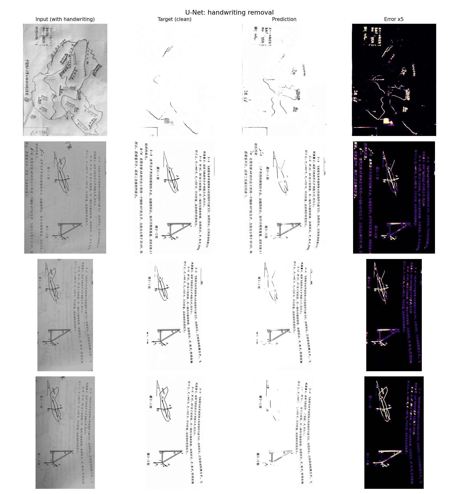
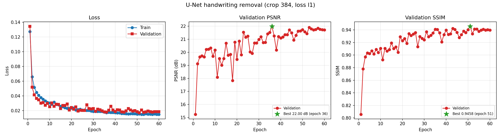
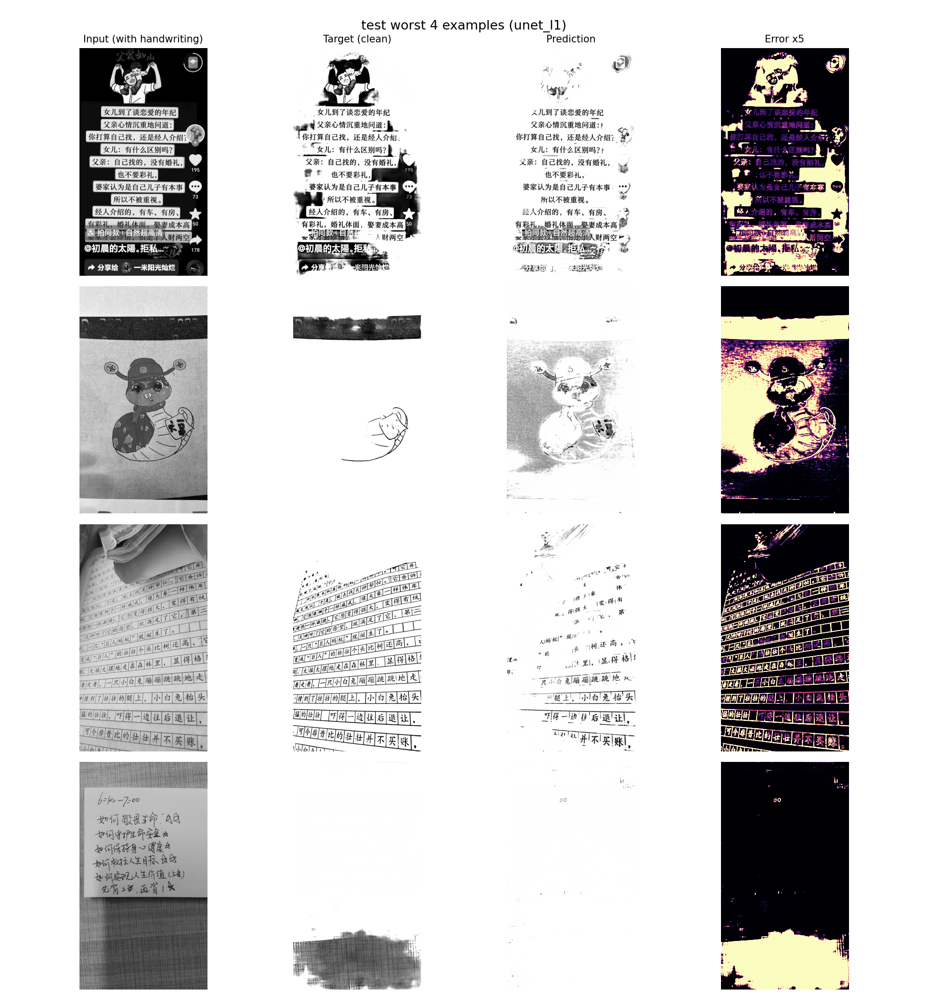

# 文档手写擦除（U-Net）

用 U-Net 做文档图像的逐像素编辑：输入一张带手写笔迹的扫描件，输出擦掉手写、保留印刷文字与表格结构的干净图。

扫描件 → 擦除结果：



四列依次是：带手写的输入、干净目标、模型预测、误差放大 5 倍。最后一列是排查工具——残留的笔迹会在误差图上直接显形，比肉眼看预测图更容易发现问题。

---

## 任务与难点

输入输出都是同一份文档的扫描件，区别只在有没有手写内容。模型要做的就是逐像素判断「这个位置该不该改」。

看起来是个简单的图像到图像任务，实际有四个坑：

尺寸不能缩。输出必须和输入逐像素对齐，擦除结果要能直接贴回原图，缩放会破坏这个对应关系。而数据集里的图长边从一百多像素到两千像素不等，横竖版都有。

细笔迹经不起糊。把两千像素的图缩到 256，手写的细笔迹会和印刷字糊在一起，任务本身退化了。

格式混杂。部分文件的扩展名是 `.jpg` 但内容其实是带 alpha 通道的 PNG，另一部分是普通三通道 JPEG，目标图则统一是单通道灰度。带 alpha 的直接转灰度会把透明区域当黑色处理，白纸上凭空多出一片灰。

大图推理吃显存。整张 2000×2000 的图送进 U-Net，第一层 64 通道的特征图就是 `64 × 400万 × 4B ≈ 1 GB`，编码器同时持有好几张这个量级的张量。

## 方法

**数据**：按批次分组，整组留出做验证/测试，而不是把图打散随机分。同一批扫描件之间高度相关——同一套卷子的印刷版面一样、光照和噪声模式也一致——随机划分会让几乎相同的图同时出现在训练集和测试集里，指标虚高。整组留出测的才是「换一批没见过的东西还能不能行」。

**模型**：标准 U-Net，编码器逐级下采样提取语义，解码器逐级上采样恢复分辨率，同层级的编码器特征通过跳跃连接直接接到解码器上。`depth=4`，即四次下采样把长宽各降到 1/16 再对称还原。参数量 31,036,481，其中瓶颈层那一级占了 45.6%。

ConvBlock 用 `kernel=3, padding=1` 的 same padding 让尺寸严格守恒，跳跃连接拼接时不需要像原论文那样做中心裁剪。上采样用转置卷积，输出接 `Conv1x1 + Sigmoid` 把结果约束在 `[0, 1]`。

**训练**：原分辨率随机裁剪 384×384，不缩放；AdamW，lr 2e-4，余弦退火，梯度裁剪 1.0，60 轮。batch size 16 并丢掉最后一个不满的 batch——BatchNorm 在训练模式下要求 batch 内样本数大于 1。

**损失**：以 L1 为主。MSE 放大大的误差、对小误差宽容，优化目标偏向把误差摊平到所有像素上，结果是边缘变软、笔迹边界留下灰影。另外做了 MSE 与 L1+梯度两种对照。

## 结果

主实验（L1 损失）：

| 项目 | 值 |
| --- | --- |
| 参数量 | 31,036,481 |
| 数据划分 | train 1712 对 / val 70 对 / test 630 对 |
| 最优 epoch | 第 36 轮 |
| 验证 PSNR / SSIM | 22.00 dB / 0.9409 |
| 测试 PSNR | 23.74 dB（最差 8.66 / 最好 54.52） |
| 测试 SSIM | 0.9584（最差 0.5225 / 最好 0.9984） |
| 退化检查 | 验证 60 轮 0 次；测试 1/630 触发阈值，经核查那张真值本身就是空白页 |
| 训练时长 / 显存峰值 | 39.0 分钟 / 13,300.8 MB（RTX 4090D） |



三种损失的对照（同配置，只改 `--loss`）：

| 损失 | 优化到的统计量 | 测试 PSNR | 测试 SSIM |
| --- | --- | --- | --- |
| MSE | 条件均值 | 24.86 dB | 0.9493 |
| L1 | 条件中位数 | 23.74 dB | 0.9584 |
| L1 + 梯度 | 中位数 + 边缘对齐约束 | 24.31 dB | 0.9620 |

结果和理论预期一致：MSE 的 PSNR 最高（PSNR 就是 MSE 的对数变换，用 MSE 当损失等于直接优化评估指标本身），L1+梯度的 SSIM 最高（梯度项显式惩罚 `|∇pred − ∇target|`，直接约束边缘）。

三者的差距最大只有 1.12 dB 和 0.013 SSIM，而单次运行的波动区间估计就有 0.5~1.5 dB——**不足以支撑「哪个损失更好」的结论**，只能说明方向不矛盾。要下结论需要开多种子重复实验。

测试集最差样本：模型在多数图上表现稳定，失效集中在手写密集处留下浅灰残影。



## 工程实现要点

这一部分是写这个项目时花时间最多的地方。

**任意尺寸可推理**：U-Net 每级下采样边长减半，输入边长必须是 16 的整数倍，否则池化向下取整丢掉的像素会让上采样后的尺寸和跳跃连接差 1~2 像素、拼接直接报错。所以推理前把图补齐到整数倍、跑完再裁回原尺寸。补齐用 replicate 而不是补 0——文档背景接近白色，补 0 会在边界拉出一条黑框，卷积经过时产生虚假的边缘响应。

**分块推理**：算好块与块之间留 64 像素重叠，逐块推理后按覆盖次数平均，消除接缝。最右和最下要额外补一块贴住边界，否则图幅不是步长整数倍时会漏掉一条。这样显存占用只和块大小有关，与实际图幅无关——第一层的激活值从 1 GB 降到 64 MB。

**退化检测**：输出退化成常数是这类任务最典型的失败模式，网络会发现「输出一片浅灰」在 L1 下就能拿到不错的平均分，于是干脆不学结构。所以每轮验证都记录预测图的标准差，低于 5e-3 判定为近似纯色并计数，出现就告警。

**指标不只看均值**：文档图大部分像素是白底且容易预测对，会把 PSNR 和 SSIM 的均值抬高。SSIM 平均 0.9584 看着不错，但最差只有 0.5225——真正反映难度的是极值，所以评估脚本按 PSNR 排序输出最差和最好的若干张。

## 快速开始

```bash
pip install -r requirements.txt
```

数据目录按分组组织，每组下面有 `input` 和 `output` 两个子目录，两边文件名一一对应：

```text
<data_root>/
├── <分组 A>/dataset/{input,output}/
├── <分组 B>/dataset/{input,output}/
└── <分组 C>/dataset/{input,output}/      ← 名称排序后的最后一组自动留出
```

```bash
# 训练（自动把最后一组留出做验证/测试）
python src/train.py --data-root /path/to/dataset --epochs 60

# 损失函数对照
python src/train.py --data-root /path/to/dataset --loss mse     --tag unet_mse
python src/train.py --data-root /path/to/dataset --loss l1_grad --tag unet_l1grad

# 测试集评估：PSNR / SSIM、退化成纯色的检查、最差与最好若干张的对比图
python src/evaluate.py --checkpoint checkpoints/unet_l1_best.pt --split test --keep 4

# 单张推理
python src/infer.py --checkpoint checkpoints/unet_l1_best.pt --input photo.jpg

# 批量推理；显存不够时用分块模式
python src/infer.py --checkpoint checkpoints/unet_l1_best.pt \
    --input-dir /path/to/dataset/<分组 C>/dataset/input --tile 512
```

显存不足时把 `--crop` 降到 256、`--batch-size` 降到 8 可以把流程跑通，但超参变了，得到的数值不会和上面的记录一致。

训练中断后用 `--resume` 续训，会从 `<tag>_last.pt` 恢复模型、优化器状态和 epoch。

## 目录结构

```text
unet-doc-restoration/
├── src/
│   ├── data.py        配对数据集、尺寸处理、按分组划分
│   ├── model.py       U-Net（编码器-解码器 + 跳跃连接）
│   ├── losses.py      L1 / MSE / L1+梯度
│   ├── metrics.py     PSNR / SSIM 与退化检测
│   ├── predict.py     尺寸补齐、分块推理、整集评估
│   ├── engine.py      训练循环（含断点续训）
│   ├── viz.py         训练曲线与四列对比图
│   ├── checkpoint.py  权重的存与读
│   ├── utils.py       路径、随机种子、指标导出
│   ├── train.py       训练入口
│   ├── evaluate.py    测试集评估
│   └── infer.py       单张 / 批量推理
└── assets/            结果图
```

产物约定：一次训练固定产出三类东西——权重落在 `checkpoints/`，全部超参、逐轮 history 与运行环境落在 `reports/metrics/<tag>.json`，收敛曲线和对比图落在 `reports/`。任何一次实验的结果都能从那份 json 单独还原出来。

## 已知局限与改进方向

数据量是主要瓶颈。1712 对训练 3100 万参数的模型，验证 PSNR 从第 20 轮起就卡在 21.7~22.0 dB 之间震荡了 40 轮没有提升，而训练损失还在下降，是典型的欠拟合。

下一步按性价比排：一是加 baseline（直接输出输入的 copy baseline、输出全白的退化 baseline），给 23.74 dB 一个参照系；二是继续试感知损失和可微 SSIM 损失，让训练目标和评估指标对齐；三是 pix2pix 式对抗损失或 Diffusion 类方法，它们能给出更锐利的细节，代价是训练不稳定或推理慢几个数量级，且通常需要更多数据。
